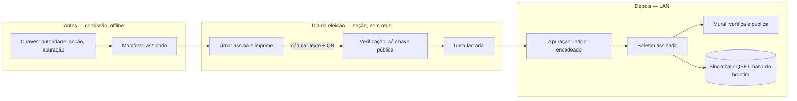

# 14 — Figuras e tabelas sugeridas

## Figuras

**Fig. 1 — Arquitetura e fluxo de uma eleição.** Mostrar as três fases: antes (comissão offline, chaves e manifesto),
votação (urna → cédula → verificação → urna lacrada, tudo sem rede) e depois (apuração → boletim assinado → mural →
âncora na blockchain). Destacar: "a rede nunca transporta votos".

**Fig. 2 — Cédula impressa (62 × 100 mm).** Texto legível em cima, linha "dobre aqui", QR assinado embaixo, id curto
da cédula no rodapé. Gerar com `urna3g demo` (PDFs em `cedulas/`) e capturar um.

**Fig. 3 — Formato binário da cédula** (diagrama de campos): versão 1 B | id da eleição 8 B | tamanho e seção | nº de
votos e votos int32 | nonce 16 B | assinatura 64 B.

**Fig. 4 — Cadeia de hashes do ledger e do mural**: registros encadeados; o hash final entra no boletim; o hash do
boletim entra no mural e na blockchain.

**Fig. 5 — Topologia do cluster**: 12 nós em malha completa (66 conexões) + computador principal como ponte. Captura do
painel ao vivo (`urna3g painel`) recomendada.

**Fig. 6 — Vazão × nº de validadores fora** (E7; `anexos/dados/e7-tolerancia.json`): barras de blocos/min (média,
com os 5 pontos individuais sobrepostos) para k = 0…4, linha tracejada em 30/min e marca do limite teórico (k = 4);
k = 5 anotado como "parada". Destacar com marcador diferente as repetições com validadores vizinhos no rodízio.

**Fig. 7 — Recuperação após perda de quórum** (E8; `anexos/dados/e8-recuperacao.json`): gráfico de pontos, eixo x =
duração da parada (10, 30, 60, 120 s), eixo y = tempo até o próximo bloco (escala log₂); linhas horizontais nos
degraus ≈ 38, 70, 135, 263, 518 s anotadas com "4 s × 2ʳ". Mostra que a recuperação é quantizada.

**Fig. 7b — Latência de ancoragem** (E6 e E10): distribuição (histograma ou *box plot*) do tempo do boletim à
ancoragem — nominal (n = 120, ~2,5 s), seções não afetadas por queda (n = 45) e seções afetadas (n = 15, ~72 s).

**Fig. 8 — Captura do painel ao vivo durante um ensaio**: grafo com as seções em fases diferentes e a linha do tempo.

## Tabelas prontas

**Tab. A — Conformidade (Brunazo & Gazziro 2014)** [FONTE]

| Critério | Brasil (UE2009) | Venezuela (SAES) | Argentina (Vot.Ar) |
|---|---|---|---|
| Gera voto impresso conferível pelo eleitor | NÃO | SIM | SIM |
| Eleitor confere a gravação digital antes de sair | NÃO | NÃO | SIM |
| Fiscal verifica a igualdade entre os registros | – | NÃO | SIM |
| Fiscal acompanha a contagem por seção | NÃO | SIM | SIM |
| Garantia contra violação do voto por erro de software | NÃO | SIM | SIM |
| Garantia contra violação por reordenação do arquivo de votos | NÃO | NÃO | SIM |
| Erro não detectado no software pode causar erro indetectável no resultado | SIM | NÃO | NÃO |
| Conformidade com VVSG §7.8 | NÃO | SIM | SIM |
| Tempo para publicar resultados por seção | 72 h (2012) | ? | 2 h (2011) |
| Troca de equipamento defeituoso / recuperação de dados | lenta / sim | lenta / sim | rápida / não |

**Tab. B — Urna brasileira × Urna 3G UFABC (Lima et al. 2017)** [FONTE]

| Critério | Urna brasileira | Urna 3G UFABC |
|---|---|---|
| Gera voto impresso conferível pelo eleitor | NÃO | SIM |
| Eleitor confere a gravação digital antes de sair | NÃO | SIM |
| Fiscal verifica igualdade entre registros | NÃO | SIM |
| Fiscal acompanha a contagem por seção | NÃO | SIM |
| Erro de software pode causar erro indetectável | SIM | NÃO |
| Tempo para publicar resultado por seção | 72 h (2012) | 1,5 h por seção de 400 votos |
| Conferência da assinatura digital do software pelo fiscal | NÃO | SIM |
| Distribuição matricial | NÃO | SIM |
| Eleitor escolhe a ordem dos cargos | NÃO | SIM |
| Plebiscitos | NÃO | SIM |
| Troca de equipamento defeituoso | LENTA | RÁPIDA |
| Necessidade de recuperação de dados | SIM | NÃO |

Nota para o artigo: à luz da revisão do código (`05`), o item "fiscal verifica igualdade entre registros" era
verdadeiro quanto ao conteúdo, mas sem garantia de origem (QR forjável). A nova versão acrescenta essa garantia.

**Tab. C — E-voting em Ethereum segundo Taş & Tanrıöver (Cunha 2022)** [FONTE]

| Critério | Koç 2018 | Khoury 2018 | Christyono 2021 | McCorry 2017 (OVN) |
|---|---|---|---|---|
| Não produzir recibo | ✓ | ✓ | ✓ | ✓ |
| Não produzir resultados preliminares | | | ? (dados insuficientes) | ✓ |
| Integridade dos dados | ✓ | ✓ | | ✓ |
| Privacidade / voto anônimo | | | | ✓ |
| Somente eleitores registrados | ✓ | ✓ | ✓ | ✓ |
| Voto único | ✓ | ✓ | ✓ | ✓ |
| Robustez (escala) | | | | |
| Confiabilidade | | | | ✓ (código precisa de atualização) |
| Verificabilidade | ✓ | ✓ | ✓ | ✓ |

**Tab. D — Protótipo 2016 × esta versão** — ver `07-criptografia-e-formatos.md` §7.6.

**Tab. E — Bateria E1–E12** — tabelas prontas em `11-resultados.md` §11.1–11.12 e em `anexos/RELATORIO-EXPERIMENTOS.md`.

**Tab. F — Defeitos revelados pelos experimentos (sistema e método)** — ver `11-resultados.md` §11.14.
